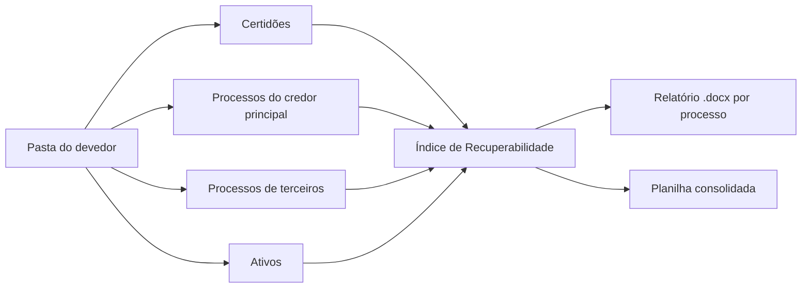

# Due diligence automatizada de créditos NPL

Lê autos inteiros, calcula o risco e entrega relatório pronto para a decisão de compra de créditos inadimplentes.

> **Confidencialidade:** esta ferramenta foi construída para uso interno de um escritório de advocacia. O código e os dados não são públicos. Este repositório documenta o problema, a solução e os resultados, sem nomes de clientes, partes ou processos.

## Problema

Antes de comprar um crédito inadimplente, é preciso analisar os processos judiciais do devedor. Cada caso traz centenas ou milhares de páginas, muitas digitalizadas.

A análise era manual: ler os autos, localizar garantias, penhoras e citações, calcular o risco e formatar o relatório. Horas de trabalho repetitivo e relatórios com estruturas diferentes.

## Como funciona

- Recebe a pasta do devedor e divide o trabalho em quatro trilhas paralelas.
- Identifica o tipo de cada ação e aplica o modelo certo, entre 13 tipos padronizados (execução, embargos, monitória, cobrança, recuperação judicial, revisional, entre outros).
- Extrai o texto, aplica OCR nas páginas digitalizadas e localiza as peças-chave.
- Calcula um Índice de Recuperabilidade com seis vetores ponderados e emite recomendação em quatro faixas.
- Toda afirmação cita a página de origem nos autos. O que não foi encontrado aparece declarado, e as limitações de leitura são listadas no fim.
- Gera um relatório .docx por processo e uma planilha consolidada por grupo de devedores.

## Ferramentas

Claude (Projetos, Cowork e Skills), Python (extração de PDF, OCR, python-docx, openpyxl), Claude API numa ferramenta web de leitura de certidões, Miro para mapear o fluxo e Google Drive para as entregas.

## Resultados

- Cerca de três semanas de operação (5 a 28 de outubro de 2026).
- 20 lotes de devedores, cerca de 114 relatórios e 8 planilhas consolidadas.
- Mais de 10 mil páginas lidas em apenas 5 lotes com contagem registrada.
- Processos de 7 tribunais estaduais e do STJ, em três sistemas (PJe, PROJUDI e eproc).
- Biblioteca de 13 skills reutilizáveis, com revisão dos modelos existentes e reescrita de dois modelos desatualizados.
