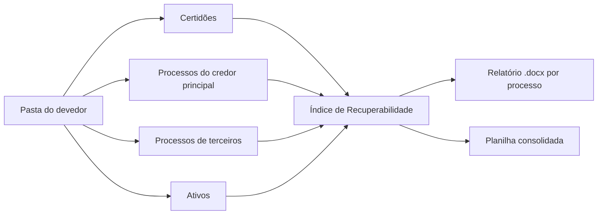

# Due diligence automatizada de créditos NPL

Lê autos inteiros, calcula o risco e entrega relatório pronto para a decisão de compra de créditos inadimplentes.

> **Confidencialidade:** a ferramenta completa foi construída para uso interno de um escritório de advocacia, e o código de produção e os dados não são públicos. Este repositório documenta o problema, a solução e os resultados, e traz uma **versão de demonstração** do cálculo de risco, com dados fictícios.

## Problema

Antes de comprar um crédito inadimplente, é preciso analisar os processos judiciais do devedor. Cada caso traz centenas ou milhares de páginas, muitas digitalizadas.

A análise era manual: ler os autos, localizar garantias, penhoras e citações, calcular o risco e formatar o relatório. Horas de trabalho repetitivo e relatórios com estruturas diferentes.

## Como funciona

- Recebe a pasta do devedor e divide o trabalho em quatro trilhas paralelas.
- Identifica o tipo de cada ação e aplica o modelo certo, entre 13 tipos padronizados (execução, embargos, monitória, cobrança, recuperação judicial, revisional, entre outros).
- Extrai o texto, aplica OCR nas páginas digitalizadas e localiza as peças-chave.
- Calcula um Índice de Recuperabilidade com seis vetores ponderados e emite recomendação em quatro faixas.
- Toda afirmação cita a página de origem nos autos. O que não foi encontrado aparece declarado, e as limitações de leitura são listadas no fim.
- Gera um relatório .docx por processo e uma planilha consolidada por grupo de devedores.



## Índice de Recuperabilidade (IR)

O coração da análise. Primeiro calcula a cobertura das garantias, depois pontua seis vetores.

**TCP (Taxa de Cobertura por Garantias):** soma das garantias, já descontados os gravames de grau anterior, dividida pela dívida atualizada, vezes 100.

**IR** = (V1 × 0,35) + (V2 × 0,20) + (V3 × 0,20) + (V4 × 0,15) + (V5 × 0,07) + (V6 × 0,03)

Cada vetor recebe apenas os scores 10, 7, 4 ou 1, sempre com a fonte nos autos.

| IR | Faixa | Conclusão sugerida |
|---|---|---|
| 8,0 a 10,0 | Baixo risco | Aquisição recomendada |
| 6,0 a 7,9 | Médio risco | Aquisição condicional |
| 3,5 a 5,9 | Alto risco | Aquisição com deságio agressivo |
| 0,0 a 3,4 | Risco crítico | Aquisição desaconselhada |

## Como foi desenvolvido

Projeto feito com **vibe coding**: o desenvolvimento foi conduzido com ferramentas de IA, a partir das minhas definições.

Meu papel:

- Mapear o problema com a equipe jurídica e transformar a análise manual em regras.
- Definir a metodologia do IR, os 13 modelos de relatório e os critérios de rastreabilidade.
- Orquestrar o fluxo em trilhas paralelas e escolher as ferramentas de cada etapa.
- Testar, validar os relatórios com os advogados e revisar os modelos desatualizados.

## Tecnologias

- **Python:** extração de PDF, OCR, python-docx e openpyxl.
- **IA:** Claude (Projetos, Cowork, Skills e API, numa ferramenta web de leitura de certidões).
- **Apoio:** Miro para mapear o fluxo e Google Drive para as entregas.
- **Demo:** Python 3.10+ e pytest.

## Como executar a demo

```bash
git clone https://github.com/yohannamunareto/due-diligence-npl-automatizada.git
cd due-diligence-npl-automatizada
pip install -r requirements.txt

python src/main.py data/caso_ficticio.json   # calcula o IR do caso fictício
python -m pytest                             # roda os testes
```

## Exemplo de uso

Entrada: `data/caso_ficticio.json`, um processo inventado com duas garantias e os seis vetores pontuados.

Saída (também em `docs/exemplo_saida.txt`):

```
Processo: 0000000-00.2026.8.00.0000 (Execução de Título Extrajudicial)
Dívida atualizada: R$ 1.250.000,00 (data-base 30/10/2026)
TCP: 86,40%

Vetor  Score  Peso  Subscore  Fonte
V1         7   35%      2.45  Mov. 12, Fls. 88
V2         4   20%      0.80  Mov. 12, Fls. 90
V3         7   20%      1.40  Mov. 31, Fls. 140
V4         4   15%      0.60  Mov. 22, Fls. 152
V5        10    7%      0.70  Mov. 1, Fls. 3
V6        10    3%      0.30  Mov. 9, Fls. 60

IR: 6,25 | MÉDIO RISCO
Conclusão sugerida: AQUISIÇÃO CONDICIONAL
Alerta: Garantia sem avaliação homologada: Penhora de trator agrícola
```

## Estrutura de pastas

```
due-diligence-npl-automatizada/
├── README.md
├── src/
│   ├── indice_recuperabilidade.py   # cálculo do TCP e do IR
│   └── main.py                      # executa um caso em JSON
├── tests/
│   └── test_indice_recuperabilidade.py
├── data/
│   └── caso_ficticio.json           # dados inventados
├── docs/
│   └── exemplo_saida.txt
├── requirements.txt
├── .gitignore
└── LICENSE
```

## Resultados

- Cerca de três semanas de operação (5 a 28 de outubro de 2026).
- 20 lotes de devedores, cerca de 114 relatórios e 8 planilhas consolidadas.
- Mais de 10 mil páginas lidas em apenas 5 lotes com contagem registrada.
- Processos de 7 tribunais estaduais e do STJ, em três sistemas (PJe, PROJUDI e eproc).
- Biblioteca de 13 skills reutilizáveis, com revisão dos modelos existentes e reescrita de dois modelos desatualizados.

## Próximos passos

- Publicar um relatório .docx de exemplo gerado a partir de um caso fictício.
- Incluir na demo a leitura de PDF com OCR, usando autos inventados.
- Medir o tempo médio por relatório, comparando com a análise manual.

## Autora

**Yohanna Munareto**, Analista de Automação e Dados.

[GitHub](https://github.com/yohannamunareto) · [LinkedIn](https://linkedin.com/in/yohanna-munareto)
